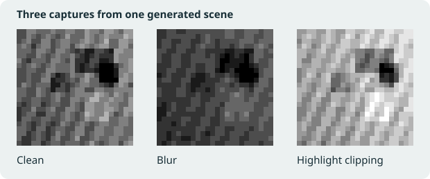

# Image Quality ML

A small ML walkthrough for flagging blur and overexposure in grayscale images. I wanted to see whether a shallow tree could catch common image-quality problems with features you can inspect. The general QA question is inspired by my work on WriVision. This portfolio demo uses generated scenes and was built with AI assistance.



## Run it

Run these from the repo root. `rpart` is a recommended package included in standard R installations. This run was verified with R 4.5.2 and `rpart` 4.1.24. If your R installation is missing `rpart`, run `install.packages("rpart")` in R.

```sh
Rscript run.R
Rscript tests/run-tests.R
```

The first command generates the dataset, fits the models, and prints the confusion matrix and tree rules. `Rscript scripts/preview.R` regenerates the example image above.

## What the pipeline does

1. **Generate images.** Start with 120 unique scenes made from geometric shapes and textures. Make nine versions of each scene across clean, blur, and highlight clipping. Vary the brightness and sensor noise between images.
2. **Build features.** Measure overall brightness, contrast, how quickly adjacent pixels change, and how many pixels are near white. Try one more feature, the 98th percentile of pixel-to-pixel change divided by the mean change. Sharp images tend to have a few strong edges, which the mean can hide.
3. **Split by scene.** Hold out 30 complete scenes for the final test. Use 22 of the remaining 90 scenes for validation. A row-level split could put nearly identical shapes in training and test through different captures of the same scene.
4. **Fit and compare.** Compare trees with and without the peak-edge ratio on validation scenes, then refit the better feature set on all 90 development scenes. Compare its final test score with a rule that always predicts the most common training label.

## Results on the generated scenes

Adding the peak-edge ratio raised validation balanced accuracy from **66.7% to 82.8%**. The refit tree reached **81.5%** on 270 images from 30 held-out scenes, compared with **33.3%** for the majority-label baseline. Balanced accuracy is the mean recall across the three classes.

| Actual | Predicted clean | Predicted blur | Predicted clipping | Recall |
| --- | ---: | ---: | ---: | ---: |
| Clean | 55 | 22 | 13 | 61.1% |
| Blur | 6 | 82 | 2 | 91.1% |
| Clipping | 7 | 0 | 83 | 92.2% |

Clean images were the weakest class. The model flagged 35 of 90 clean images, including 22 as blur. In the fitted tree, a high share of near-white pixels drives the first split. Below that threshold, the peak-edge ratio helps separate blur from clean captures. Soft-edged scenes and bright regions can still look like defects to these features.

The generator applies one labeled defect at a time and uses simple shapes. The scores measure performance on that simulator. I would test mixed defects and group by camera or source before using the same approach on real images.
